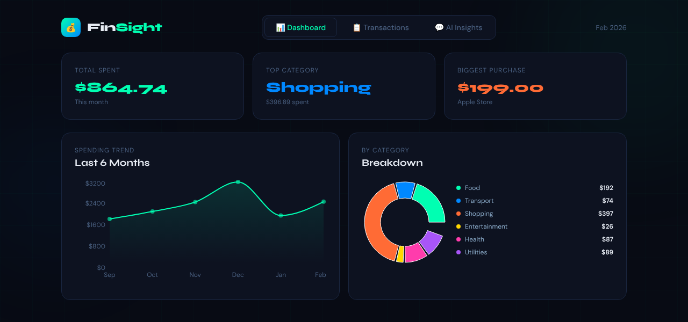
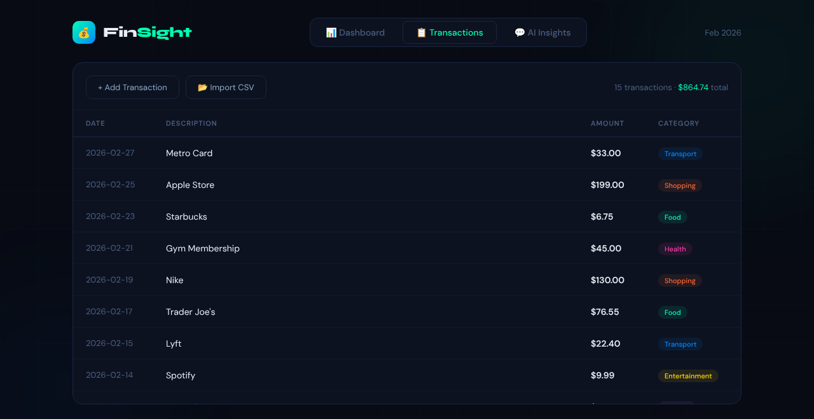

# FinSight

A personal finance dashboard built with React. It charts where your money
goes, lets you add or import transactions, and has an AI chat that answers
questions about your spending using your own category totals.

**Stack:** React 19 · Recharts · Create React App · LLM API (Anthropic Messages API)





## Features

- **Dashboard**
  - Summary cards for total spent, top category and biggest purchase.
  - A donut chart that breaks spending down across 7 categories (Food,
    Transport, Shopping, Entertainment, Health, Utilities, Other). It's
    recomputed from the transaction list whenever it changes.
  - A 6-month spending trend area chart. The trend currently uses built-in
    sample data.
- **Transactions**
  - A table of every transaction, newest first, with the count and total.
  - A form to add one by hand (date, description, amount, category).
  - CSV import. Rows with a missing date or description, or an amount that
    isn't a number, are skipped.
- **AI Insights**
  - A chat where you ask things like "Where am I overspending?".
  - Each question goes to the LLM with your per-category totals and overall
    total as context, so the answers are about your actual numbers.
  - Suggested-question buttons to get started.

## Getting started

```bash
npm install
npm start          # http://localhost:3000
```

The dashboard and transactions work with no setup. To turn on the AI chat,
create a `.env` file in the project root and restart `npm start`:

```bash
REACT_APP_ANTHROPIC_KEY=your-api-key
```

`.env` is in `.gitignore`. Keep it that way, and never commit a key.

## Importing a CSV

The first line is treated as a header and skipped. Columns are
`date,description,amount,category`:

```csv
date,description,amount,category
2026-03-01,Whole Foods Market,94.32,Food
2026-03-02,Uber,18.50,Transport
2026-03-04,Netflix,15.99,Entertainment
```

If the category is blank, the row goes under **Other**. An import replaces
the current transaction list. The parser splits on commas, so descriptions
can't contain commas.

## Limitations and next steps

This is a front-end-only project, so a few things work differently from
how a production app would do them:

- **The API key is in the browser bundle.** Create React App inlines every
  `REACT_APP_*` variable into the built JavaScript, and the chat calls the LLM
  API from the browser through a public CORS proxy (`corsproxy.io`). Only run
  it locally with a key that has a low spending limit, and don't deploy a
  build that has a key in it. The fix is a small backend endpoint that holds
  the key and makes the LLM call for the browser.
- **Nothing is saved.** Transactions live in React state and reset on reload.
  Persisting them (`localStorage` or a database) is the next step.
- **The 6-month trend uses sample data.** It could be computed from the
  transaction dates instead.

## Project layout

```
src/App.js       the whole app: state, charts, transactions, CSV import, chat
src/index.js     React entry point
public/          HTML shell and icons
```

## Scripts

| command | |
|---|---|
| `npm start` | dev server with hot reload |
| `npm run build` | production build in `build/` |
| `npm test` | Jest + React Testing Library smoke tests (dashboard totals, adding a transaction) |
